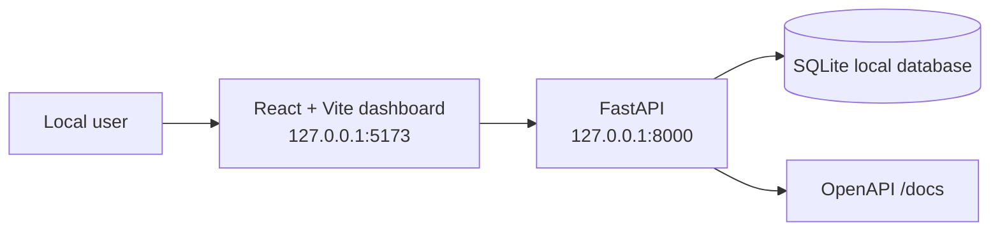
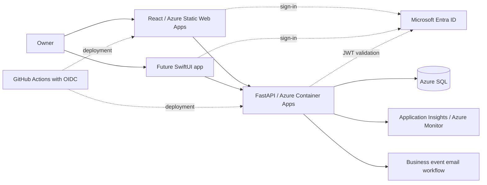

# CamGotIT Cloud Portal

A local IT service operations prototype for CamGotIT: manage service tickets, capture manual leads, and track internal alerts through a React dashboard backed by FastAPI and SQLite.

**Status: local prototype. Azure hosting, Entra authentication, and cloud delivery are planned.** The API has no authentication; run it on localhost with fictional data only.

## Implemented today

- Create and list tickets, assign normal or urgent priority, and update ticket status.
- Persist tickets, leads, and alerts in local SQLite using SQLAlchemy.
- Record an internal alert when a ticket is created and acknowledge it in the dashboard.
- Capture manual leads and generate deterministic reply templates for human review.
- Display ticket, lead, and alert counts in a React + Vite dashboard.
- Validate API requests with Pydantic and exercise core workflows with pytest.
- Inspect the API through FastAPI's generated OpenAPI documentation.

Ticket deletion is not implemented. Reply drafts do not call an AI model or send messages. Alerts are local records, not email, SMS, or push notifications.

## Architecture: current local implementation



## Architecture: planned Azure direction

The following is a design target, not a deployed environment or a claim of completed work.



Azure SQL eligibility, region, hosting settings, and cost estimates must be verified before provisioning. Infrastructure as code, deployment workflows, authentication, telemetry, email delivery, and the mobile app are not included in this starter. The existing marketing website is separate; its forms do not feed this API.

See [architecture decisions](docs/architecture.md), [roadmap](docs/roadmap.md), and [cost guardrails](docs/cost-guardrails.md).

## Run locally — PowerShell on macOS

Prerequisites: Python 3.12+, Node.js 20+, npm, and PowerShell. Start from the repository root.

### Terminal 1: API

If your existing Terminal 1 already has the API running, leave it running. For a fresh setup:

```powershell
Set-Location ./api
python3 -m venv .venv
& ./.venv/bin/Activate.ps1
python -m pip install -r requirements-dev.txt
python -m pytest -q
python -m uvicorn app.main:app --host 127.0.0.1 --port 8000 --reload
```

If the environment already exists, skip creating it and activate it with the same command. No Windows execution-policy change is needed on macOS.

### Terminal 2: dashboard

In a second PowerShell terminal, start from the repository root:

```powershell
Set-Location ./web
npm install
npm run dev
```

Open [the dashboard](http://127.0.0.1:5173), [API documentation](http://127.0.0.1:8000/docs), or [health endpoint](http://127.0.0.1:8000/health).

The dashboard defaults to `http://127.0.0.1:8000`. Optionally copy `web/.env.example` to `web/.env` to configure `VITE_API_URL`. Frontend environment variables are public browser configuration; never put secrets in them. The API reads `DATABASE_URL` from the process environment and does not automatically load a `.env` file.

## Demo walkthrough

1. Create a fictional ticket for “Demo Household” with the issue “Printer is offline.”
2. Confirm the ticket appears in the queue and creates an internal alert.
3. Change its status to `in_progress`, then `resolved`.
4. Acknowledge the alert and check the dashboard counts.
5. Add a fictional manual lead and view its reply draft. Nothing is sent automatically.

The API creates `api/camgotit-dev.db` locally. Database files, virtual environments (including backups), local configuration, and build output are excluded from Git.

## Validation

From `api/` with the Python environment activated:

```powershell
python -m pytest -q
```

The four existing tests cover health, ticket creation/status updates and alerts, manual lead drafts, and selected validation/not-found cases. They use a separate temporary database. They do not verify Azure deployment, authentication, or browser behavior.

From `web/`, after installing dependencies:

```powershell
npm run build
```

## Repository layout

```text
api/app/          FastAPI routes, validation, and SQLite models
api/tests/        Isolated API workflow tests
web/              React + Vite dashboard
infra/            Read-only Azure preflight script; no deployment definitions
docs/             Architecture, roadmap, and planning notes
```

## Engineering focus and next milestones

This portfolio project demonstrates connecting a React client to a Python API, validating requests, persisting relational data, modeling ticket events, and testing core workflows. The cloud design documents the next engineering steps:

1. Add Entra sign-in, API token validation, ownership/role checks, and audit history.
2. Add reproducible infrastructure and GitHub Actions delivery with OIDC.
3. Deploy a synthetic-data Azure development environment with monitoring and cost controls.
4. Implement reliable business-event email delivery.
5. Add a SwiftUI client that shares the same authenticated API.

Additional lead automation and AI assistance remain future experiments. Use the roadmap to track completion rather than treating the target architecture as deployed functionality.
