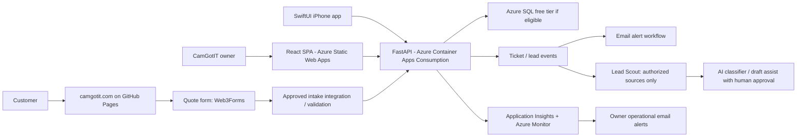

# CamGotIT Cloud Portal architecture (v0.1)

## Decisions to preserve

- Use the existing CamGotIT workforce Entra tenant and `CamGotIT-Lab` Azure subscription; no separate customer identity tenant in the owner-only MVP.
- Azure region candidate: East US 2, subject to eligibility and pricing checks.
- Owner-only access initially; model `Portal.Technician` for future use but do not assign it yet.
- Public GitHub repo `camgotit-cloud-portal`; use GitHub Actions OIDC and no stored Azure client secrets.
- Azure development cost target <= $30/month; this is a planning limit, not a hard spending cap.
- Only synthetic data until all customer-data controls are complete.
- Preserve original MVP acceptance test: authenticated owner creates a ticket on the web, sees it on iOS, updates status from iOS, sees updated state on web using **one API**, with CI/CD, telemetry, and an alert.

## Target production topology (not yet deployed)

**Important:** The production intake gateway, authentication, API access controls, and event notification provider require implementation and security review before real data can flow. Web3Forms is currently the production website's form provider; it is not integrated with this starter API.

## Notification split

- New customer request / ticket = **business event**. Implement an application event that emails the owner, with deduplication and retries; SMS/push later.
- API failure, exception, high latency, cost anomaly = **platform incident**. Use Azure Monitor and Action Groups.
- Don't assume Azure Monitor alone can directly page reliably for every individual customer form submission.

## Nextdoor integration rule

Use free Business Page posts and manually saved/permissioned opportunities in Phase 1. Nextdoor has Search/Content and Publishing APIs but they require approval. No scraping, unauthorized access, contact harvesting, automated unsolicited DMs or auto-posting. Keep human approval on any proposed reply.

## Card/Flyer

- The first QR and NFC destination can be `https://camgotit.com/#contact`, hosted on the existing site. Do not require Azure or new subscriptions for this.
- Later create a public `/card` or `/contact` landing page that tracks aggregate visits without collecting more data than necessary; physical NFC cards are programmed separately.

## AI agent safety and spend controls

- Start by drafting FAQ answers and gathering issue details; never invent availability, guarantee repairs, or send sensitive material to an LLM by default.
- Outbound customer messages need opt-in/valid communication basis and owner-reviewed templates initially.
- Define escalation to human and audit logs. Test with fictional data.
- Keep model calls behind an explicit feature flag and daily usage limit. Azure model inference can incur separate charges.
